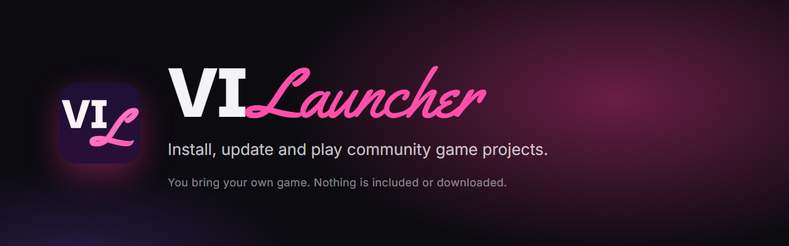
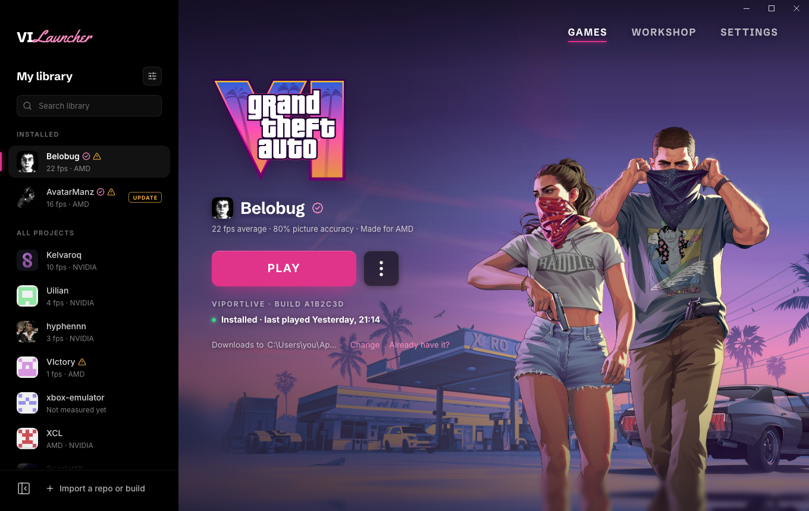
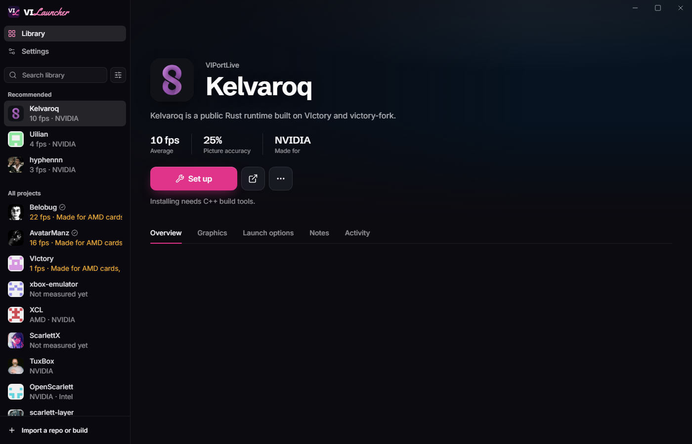

<h1 align="center">
  
</h1>

<p align="center">
  <a href="README.md" lang="en" hreflang="en">English</a> ·
  <a href="README.zh-TW.md" lang="zh-Hant" hreflang="zh-Hant">繁體中文</a> ·
  <b lang="zh-Hans">简体中文</b>
</p>

<p align="center">
  <a href="LICENSE"></a>
  <a href="https://github.com/dazacode/vilauncher/actions/workflows/build.yml"></a>
  <a href="https://github.com/dazacode/vilauncher/releases/latest"></a>
</p>

> 这是英文版 [README.md](README.md) 的翻译。如果内容有出入或尚未更新，以英文版为准。标有（英文）的链接只有英文版。

一款社区游戏项目的启动器，支持 Windows、macOS 和 Linux。它会列出 [VIPortLive](https://viportlive.com) 上的项目，用 Git 和 Cargo 下载并构建，再用**你自己的游戏文件**启动。



> **不含任何游戏**。VILauncher 不附带也不下载任何游戏文件，并且与 Rockstar Games、Take-Two Interactive 或任何其他发行商无关。请参阅 [LEGAL.md](LEGAL.md)（英文）。

## 由来

VILauncher 分叉自 Zettrox 的 [Mandyhub](https://github.com/TheGameOnAddict/mandyhub-sinkfinger)，由 VIPortLive 团队重新设计并扩展。它的功能已经远远超过 Mandyhub：

- 项目库不限于 VIctory 构建版本。任何有 Git URL 的 Rust 项目、任何预构建的 ZIP，以及任何已经在你电脑上的构建版本，都能用同样的方式添加和管理。
- 它会检查项目自己的说明和报告中的已知问题，并能修复和验证其中的许多问题（请参阅[功能](#功能)）。
- 它提供更新的一级还原、磁盘空间管理、可以打开 GitHub issue 的“反馈问题”按钮，以及面向开发者的可选 AI 代理接口。

首次启动时会沿用 Mandyhub 的设置和已安装的项目，不必白白重新构建。

## 你可以和不可以做什么

**你可以分叉它，我们也希望你这样做**。代码采用 GPL-3.0-or-later 许可证。你可以使用、研究、修改和再分发它，包括作为你自己启动器的基础，或者回馈贡献。许可证要求你分发的任何副本或修改版本：

- 保持 GPL-3.0-or-later 许可证，并附带源代码；
- 保留版权和许可证声明，并注明 Mandyhub 和 VILauncher 的作者；
- 清楚标明你改了什么。

**你不能把它变成闭源**。你分发的修改版本必须以相同的许可证发布。这是 GPL 定下的规则，不是我们的请求。

**这些项目不是我们的**。VILauncher 管理的是其他人制作的项目。它不审查、不认证，也不担保它们的代码。运行前请先看一看。

**Rockstar 和 GTA**。VILauncher 显示的社区项目，适用于一款你必须已经拥有其文件的游戏。它从不包含、下载或分发游戏文件。Rockstar Games 和 Take-Two Interactive 与本项目无关，也从未为其背书。他们的名称和商标归他们所有。

## 最新动态

最新版本、版本说明和下载文件始终在 [Releases](https://github.com/dazacode/vilauncher/releases/latest)。顶部的徽章会自动更新：版本徽章显示最新版本，构建徽章显示 `main` 分支能否构建成功。

## 下载

从 [Releases](https://github.com/dazacode/vilauncher/releases/latest) 获取：

- **Windows**：`VILauncher.exe`（便携版）或安装程序。
- **macOS**：`.dmg`（通用版：Apple 芯片和 Intel）。把 VILauncher 拖到“应用程序”。Gatekeeper 和如何检查下载文件：[docs/MACOS.md](docs/MACOS.md)（英文）。
- **Linux**：AppImage 或 `.deb`。

在 Windows 和 macOS 上，启动器会在启动时检查自身更新，验证下载文件的 SHA-256 摘要后替换自身（Windows 上是便携版 exe，macOS 上是整个 app）。在 Linux 上，请从 Releases 更新。

列表中的预构建版本是 Windows 程序。在 macOS 和 Linux 上可以安装，但运行时需要兼容层；Rust 项目则会原生构建和运行。

### 杀毒软件误报

已签名的版本可以用 `Get-AuthenticodeSignature` 验证（签名者：VIPortLive team），版本页面上也有 SHA-256 摘要；版本尚未签名时，请改为比对 SHA-256。Trapmine 等机器学习引擎偶尔仍会把新的构建版本标记为威胁。原因和报告方式：[docs/FALSE-POSITIVES.md](docs/FALSE-POSITIVES.md)（英文）。

### Linux

启动器可以在 Linux 上原生运行。请使用同一个版本页面上的 **AppImage**（`VILauncher_<version>_amd64.AppImage`）或 **.deb**：

```sh
chmod +x VILauncher_*_amd64.AppImage
./VILauncher_*_amd64.AppImage
```

- `VILauncher.exe` 是 Windows 版。在 Proton 下运行需要 Microsoft 的 WebView2 运行时，而 Proton 不提供。请用 Protontricks（`protontricks <appid> webview2`）或 Winetricks（`WINEPREFIX=<prefix> winetricks webview2`）把它安装到你运行时使用的 Proton prefix 中。建议改用 AppImage 或 .deb。
- 启动器在启动时会关闭 WebKit 的 DMA-BUF 渲染器。如果窗口一直是白色，可以用 `WEBKIT_DISABLE_DMABUF_RENDERER=0` 启动，试试另一种设置。
- 游戏是 Windows 程序。启动器可以在 Linux 上构建并启动它们，但某个游戏能否运行，取决于游戏本身和 Proton。

## 功能

- **项目库**：来自 VIPortLive 的项目、你自己的 Git 仓库，以及预构建的 ZIP。每个项目都会显示报告的帧率、制作时针对的显卡，以及是否已验证。VIPortLive 已下架的项目默认隐藏；你可以选择显示，此时它会打开 VIPortLive 上的页面。
- **适配警告**：启动器会读取你的显卡、内存和处理器，并与每个构建版本作者报告的数据比较。不匹配的构建版本会显示警告；这是作者实际看到的用量，不是最低要求。你可以在“高级：按电脑配置”中自行设置内存和显存。没有“推荐”列表：这些项目还太新，无法根据报告排名。
- **筛选和排序**：按名称、帧率、星标数或最近的提交排序；按等级和显卡筛选。
- **工具配置**：查找 Git、Rust 以及 Rust 链接时需要的构建工具，并安装缺少的工具：Windows 上用 winget（C++ 构建工具），macOS 上用 Apple 的安装程序和 rustup（Xcode Command Line Tools）。系统会先征求你的许可。
- **安装、更新、开始游戏**：只下载并构建一次，之后就会保留。更新时，未提交的更改会保存为补丁文件，上一个构建版本会保留以便一步还原，并且会先显示警告。
- **修复已知问题**：在开始游戏前，以及在“活动”标签页中，启动器会检查项目自己的说明和构建中的已知问题，并修复能修复的部分。Agility SDK 文件取自 Microsoft 的 NuGet 包，并用固定的 SHA-256 哈希值核对；会查找缺少的文件、安装工具、清除缓存，并在内存不足或设备丢失导致崩溃后调低图形设置。每个结果都会再读回确认。
- **反馈问题**：任务失败后，点一下即可打开已填好日志的 GitHub issue。名称和文件夹会先被移除。在你于 GitHub 上按下 Submit 之前，不会发送任何内容。
- **存储**：“设置”会显示每个项目占用的磁盘空间（源代码、构建版本、上一个构建版本、着色器缓存、存档）。你可以清除上一个构建版本和着色器缓存。存档永远不会从这里清除。
- **存档**：继续某个存档、重新开始、从另一个构建版本复制，或者从命名的检查点开始。导入或导出存档 ZIP。
- **启动预设和图形**：每个项目可以有命名的参数和环境变量预设，以及单独的图形设置。
- **预编译着色器**：在支持的项目第一次启动前构建着色器缓存。
- **活动日志**：完整的 Git 和 Cargo 输出，可以复制和导出。每个任务的日志也会保存在磁盘上。
- **AI 代理访问（默认关闭）**：让 AI 代理读取日志，并在你确认后应用补丁并运行项目的构建。请参阅[代理工具](#代理工具agent-tools)。
- **截图模式**：隐藏名称、路径、笔记和日志，方便分享截图。
- **语言**：English、繁體中文和简体中文。默认跟随系统语言，也可以在“设置 → 外观 → 语言”中选择。项目名称、说明和构建日志保持原文。要添加或改进语言，请参阅 [docs/I18N.md](docs/I18N.md)（英文）。

## 截图



截图中的界面是英文，使用浏览器模拟后端的示例数据，不是真实的电脑或账号。项目库页面上的 GTA VI 主视觉和标志归 Rockstar Games 所有，仅用于识别游戏；请参阅 [assets/gta6-src](assets/gta6-src/README.md)（英文）。

## 系统要求

- Windows 10 或 11，64 位，需要 WebView2（Windows 自带；如果缺少，安装程序会自动下载）
- 或 macOS 13 及以上版本，Apple 芯片或 Intel
- 或带有 WebKitGTK 4.1 的 64 位 Linux 桌面
- 项目需要的任何游戏，你自己的副本
- 构建 Rust 项目需要 Git、Rust 和构建工具：Windows 上是 C++ 构建工具，macOS 上是 Xcode Command Line Tools，Linux 上是 C 编译器（VILauncher 可以在 Windows 和 macOS 上安装它们）

## 数据存放位置

| 路径 | 内容 |
| --- | --- |
| `%LOCALAPPDATA%\VILauncher`（Windows）、`~/Library/Application Support/VILauncher`（macOS）、`~/.local/share/VILauncher`（Linux） | 仓库、构建版本、着色器缓存、存档和配置文件（`data`）、上一个构建版本、补丁、日志。安装文件夹可以在“设置”中更改。 |
| `%APPDATA%\VILauncher\settings.json`（Windows）；macOS 和 Linux 上是上述文件夹中的 `settings.json` | 设置 |

存档位于 `data`，更新、还原或清除缓存都永远不会动到它们。

## 从源代码构建

需要 Node.js 22、pnpm 10 和 Rust stable。开发期间，界面也能在普通浏览器中配合模拟后端运行。

```sh
pnpm install
pnpm tauri dev     # 以热重载运行
pnpm tauri build   # 发布版构建
```

输出：

- Windows：`src-tauri\target\release\VILauncher.exe` 和 `src-tauri\target\release\bundle\nsis\VILauncher_<version>_x64-setup.exe`
- macOS：`src-tauri/target/release/bundle/macos/VILauncher.app` 和 `bundle/dmg/`（一个 app 同时支持两种处理器：请参阅 [docs/MACOS.md](docs/MACOS.md#building-on-a-mac)（英文））
- Linux：`src-tauri/target/release/bundle/appimage/` 和 `bundle/deb/`

### 像 CI 一样检查构建

```sh
pnpm ci:check                                  # 安装、类型检查、翻译、vite 构建、cargo test
node scripts/ci.mjs --only typecheck,test      # 只运行部分步骤
node scripts/ci.mjs --tauri --keep-going       # 同时构建安装程序，并运行每个步骤
node scripts/ci.mjs --json                     # 同时写入 .ci/last-run.json
```

每个步骤都会打印 PASS 或 FAIL 和耗时；失败的步骤会显示其输出的最后 40 行。只有每个运行过的步骤都通过，退出码才会是 0。CI 会在每次推送和拉取请求时运行相同的检查；`v*` 标签会发布新版本。

## 代理工具（Agent tools）

`scripts/vilauncher-agent.mjs`（用 `pnpm agent <command>` 运行）让 AI 代理查看启动器的项目和构建版本、读取日志、运行启动器自己的“修复并验证”，并把代理的修复做成补丁，让你先审查。只读命令随时可用。任何会更改文件的操作，都需要在启动器中打开 **AI 代理访问** 设置，并在命令中加上 `--yes`。运行 `pnpm agent help` 可以查看命令列表和安全规则。

可选：REA MCP 服务器（`npx rea-agents@6.10.1 mcp`，MIT 许可证，来自 [morluto/rea](https://github.com/morluto/rea)）为代理提供逆向工程工具。它的原生分析需要你自己安装 Hopper、Ghidra、IDA 或 Kuna。请只用它分析你有权分析的构建版本。VILauncher 不附带 REA。

## 参与贡献

欢迎贡献。提交拉取请求前，请先阅读 [CONTRIBUTING.md](CONTRIBUTING.md)（英文）。简单来说：大的改动请先开 issue，运行 `pnpm ci:check`，并让改动保持专注。

**项目**本身的问题（它的游戏、代码、结果）请找该项目的作者。**列表**的问题请找 VIPortLive。**VILauncher 本身**的问题请在这里报告。

## 项目结构

| 路径 | 内容 |
| --- | --- |
| `src/` | React 界面（TypeScript、Tailwind CSS） |
| `src/dev/mock.ts` | 浏览器用的模拟后端 |
| `src-tauri/` | Rust 启动器（Tauri 2）：项目列表、Git 和 Cargo 任务、存档、预设、更新、诊断 |
| `src-tauri/src/brand.rs` | 名称、链接、文件夹和项目列表来源 |
| `src-tauri/src/platform/` | Windows、macOS 和 Linux 之间的差异 |
| `scripts/` | CI 检查（`ci.mjs`）和代理工具（`vilauncher-agent.mjs`） |

项目列表来自 `https://viportlive.com/api/launcher`。如果无法访问，则改用 PortWatch 的 `tracker.json`。

## 法律声明

VILauncher 是项目管理工具。它不包含、下载或分发任何游戏、游戏构建版本或游戏文件。项目需要的任何游戏，你都必须自己提供副本。你要为自己安装、构建和运行的内容负责，也要确保你有权使用你提供的文件。本软件不提供任何担保，VILauncher 与任何游戏发行商或开发商无关。

完整条款请见 [LEGAL.md](LEGAL.md)（英文）。启动器第一次启动时会用你的语言显示这份声明，并请你同意后才打开项目库。译文与英文版有出入时，以英文版为准。

## 致谢

- 分叉自 Zettrox 和 Mandyhub 贡献者的 [Mandyhub](https://github.com/TheGameOnAddict/mandyhub-sinkfinger)
- 启动器重新设计：ellion369
- macOS 移植：Dolo22
- Linux 支持：karrot0
- 存档选择器、检查点、预设和构建跟踪：TheGameOnAddict
- VIctory：Marvisak 及其贡献者
- 项目列表和跟踪数据来自 PortWatch，由 VIPortLive 提供
- 字体：Inter 和 Schibsted Grotesk（SIL Open Font License）、Yellowtail（Apache License 2.0），通过 Fontsource 获取

## 许可证

GPL-3.0-or-later。请参阅 [LICENSE](LICENSE)（英文）。第三方组件保留各自的许可证。
