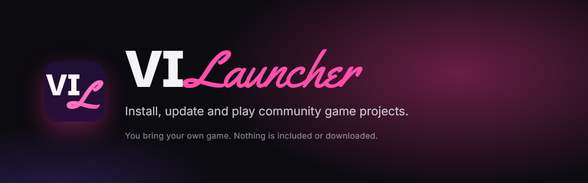
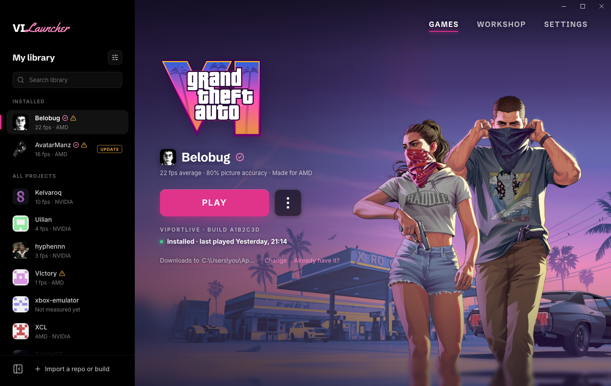
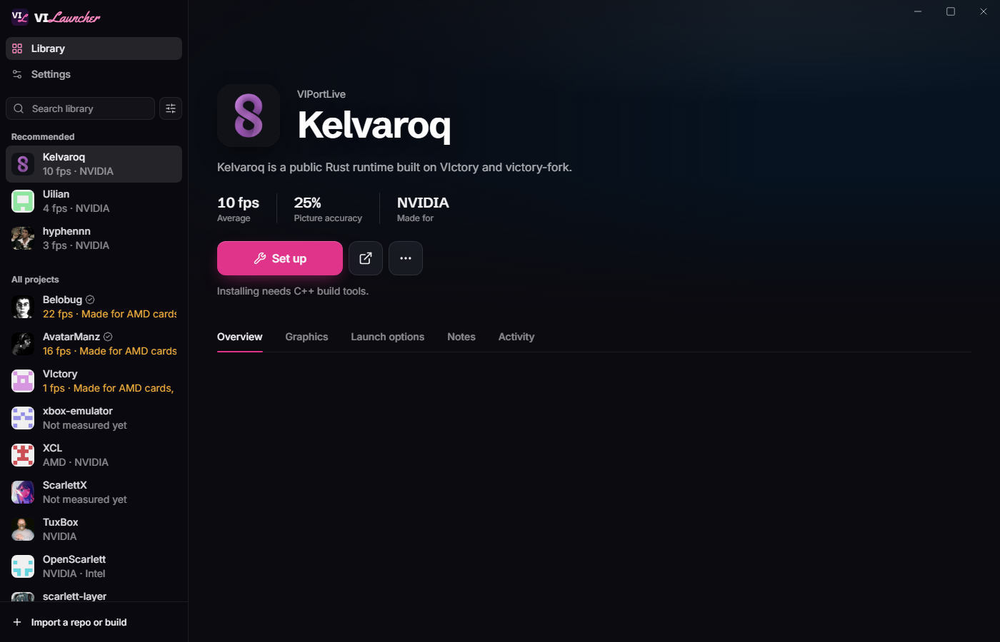

<h1 align="center">
  
</h1>

<p align="center">
  <a href="README.md" lang="en" hreflang="en">English</a> ·
  <b lang="zh-Hant">繁體中文</b> ·
  <a href="README.zh-CN.md" lang="zh-Hans" hreflang="zh-Hans">简体中文</a>
</p>

<p align="center">
  <a href="LICENSE"></a>
  <a href="https://github.com/dazacode/vilauncher/actions/workflows/build.yml"></a>
  <a href="https://github.com/dazacode/vilauncher/releases/latest"></a>
</p>

> 這是英文版 [README.md](README.md) 的翻譯。若內容有出入或尚未更新，以英文版為準。標示（英文）的連結只有英文版。

一款社群遊戲專案的啟動器，支援 Windows、macOS 和 Linux。它會列出 [VIPortLive](https://viportlive.com) 上的專案，用 Git 和 Cargo 下載並建置，再以**你自己的遊戲檔案**啟動。



> **不含任何遊戲**。VILauncher 不附帶也不下載任何遊戲檔案，且與 Rockstar Games、Take-Two Interactive 或任何其他發行商無關。請參閱 [LEGAL.md](LEGAL.md)（英文）。

## 由來

VILauncher 分支自 Zettrox 的 [Mandyhub](https://github.com/TheGameOnAddict/mandyhub-sinkfinger)，由 VIPortLive 團隊重新設計並擴充。它的功能已遠遠超過 Mandyhub：

- 專案庫不限於 VIctory 建置版本。任何有 Git URL 的 Rust 專案、任何預先建置的 ZIP，以及任何已在你電腦上的建置版本，都能用同樣的方式新增和管理。
- 它會檢查專案本身的說明和回報中的已知問題，並能修復及驗證其中許多問題（請參閱[功能](#功能)）。
- 它提供更新的一層還原、磁碟空間管理、可開啟 GitHub issue 的「回報問題」按鈕，以及給開發者使用的選用 AI 代理介面。

首次啟動時會沿用 Mandyhub 的設定和已安裝的專案，不必白白重新建置。

## 你可以和不可以做什麼

**你可以分支它，我們也希望你這麼做**。程式碼採用 GPL-3.0-or-later 授權。你可以使用、研究、修改和再散布它，包括作為你自己啟動器的基礎，或回饋貢獻。授權條款要求你散布的任何副本或修改版本：

- 維持 GPL-3.0-or-later 授權，並附上原始碼；
- 保留著作權和授權聲明，並註明 Mandyhub 和 VILauncher 的作者；
- 清楚標示你修改了什麼。

**你不能把它變成閉源**。你散布的修改版本必須以相同的授權條款釋出。這是 GPL 訂下的規則，不是我們的請求。

**這些專案不是我們的**。VILauncher 管理的是其他人製作的專案。它不審查、不認證，也不擔保它們的程式碼。執行前請先看過。

**Rockstar 和 GTA**。VILauncher 顯示的社群專案，適用於一款你必須已經擁有其檔案的遊戲。它從不包含、下載或散布遊戲檔案。Rockstar Games 和 Take-Two Interactive 與本專案無關，也未曾為其背書。他們的名稱和商標屬於他們所有。

## 最新消息

最新版本、版本說明和下載檔案一律在 [Releases](https://github.com/dazacode/vilauncher/releases/latest)。頂端的徽章會自動更新：版本徽章顯示最新版本，建置徽章顯示 `main` 分支能否建置成功。

## 下載

從 [Releases](https://github.com/dazacode/vilauncher/releases/latest) 取得：

- **Windows**：`VILauncher.exe`（免安裝版）或安裝程式。
- **macOS**：`.dmg`（通用版：Apple 晶片和 Intel）。把 VILauncher 拖到「應用程式」。Gatekeeper 和如何檢查下載檔案：[docs/MACOS.md](docs/MACOS.md)（英文）。
- **Linux**：AppImage 或 `.deb`。

在 Windows 和 macOS 上，啟動器會在啟動時檢查自己的更新，驗證下載檔案的 SHA-256 摘要後替換自己（Windows 上是免安裝版 exe，macOS 上是整個 app）。在 Linux 上，請從 Releases 更新。

清單中的預先建置版本是 Windows 程式。在 macOS 和 Linux 上可以安裝，但執行時需要相容層；Rust 專案則會原生建置和執行。

### 防毒軟體誤報

已簽署的版本可以用 `Get-AuthenticodeSignature` 驗證（簽署者：VIPortLive team），版本頁面上也有 SHA-256 摘要；版本尚未簽署時，請改為比對 SHA-256。Trapmine 等機器學習引擎偶爾仍會把新的建置版本標記為威脅。原因及回報方式：[docs/FALSE-POSITIVES.md](docs/FALSE-POSITIVES.md)（英文）。

### Linux

啟動器可以在 Linux 上原生執行。請使用同一個版本頁面上的 **AppImage**（`VILauncher_<version>_amd64.AppImage`）或 **.deb**：

```sh
chmod +x VILauncher_*_amd64.AppImage
./VILauncher_*_amd64.AppImage
```

- `VILauncher.exe` 是 Windows 版。在 Proton 下執行需要 Microsoft 的 WebView2 執行階段，而 Proton 並未提供。請用 Protontricks（`protontricks <appid> webview2`）或 Winetricks（`WINEPREFIX=<prefix> winetricks webview2`）把它安裝到你執行時使用的 Proton prefix 中。建議改用 AppImage 或 .deb。
- 啟動器在啟動時會關閉 WebKit 的 DMA-BUF 渲染器。如果視窗一直是白色，可以用 `WEBKIT_DISABLE_DMABUF_RENDERER=0` 啟動，試試另一種設定。
- 遊戲是 Windows 程式。啟動器可以在 Linux 上建置並啟動它們，但某個遊戲能否執行，取決於遊戲本身和 Proton。

## 功能

- **專案庫**：來自 VIPortLive 的專案、你自己的 Git 儲存庫，以及預先建置的 ZIP。每個專案都會顯示回報的影格率、製作時針對的顯示卡，以及是否已驗證。VIPortLive 已下架的專案預設會隱藏；你可以選擇顯示，此時它會開啟 VIPortLive 上的頁面。
- **相容性警告**：啟動器會讀取你的顯示卡、記憶體和處理器，並和每個建置版本作者回報的數據比較。不相配的建置版本會顯示警告；這是作者實際觀察到的用量，不是最低需求。你可以在「進階：依電腦規格」中自行設定記憶體和顯示記憶體。沒有「推薦」清單：這些專案還太新，無法依回報排名。
- **篩選與排序**：依名稱、影格率、星數或最近的提交排序；依等級和顯示卡篩選。
- **工具設定**：尋找 Git、Rust 以及 Rust 連結時需要的建置工具，並安裝缺少的工具：Windows 上用 winget（C++ 建置工具），macOS 上用 Apple 的安裝程式和 rustup（Xcode Command Line Tools）。系統會先徵求你的許可。
- **安裝、更新、開始遊戲**：只下載並建置一次，之後就會保留。更新時，未提交的變更會存成修補檔，上一個建置版本會保留以便一步還原，而且會先顯示警告。
- **修復已知問題**：在開始遊戲前，以及在「活動」分頁中，啟動器會檢查專案本身的說明和建置中的已知問題，並修復能修復的部分。Agility SDK 檔案取自 Microsoft 的 NuGet 套件，並以固定的 SHA-256 雜湊值核對；會搜尋缺少的檔案、安裝工具、清除快取，並在記憶體不足或裝置遺失造成當機後調低圖形設定。每個結果都會再讀回確認。
- **回報問題**：工作失敗後，按一下即可開啟已填入記錄的 GitHub issue。名稱和資料夾會先移除。在你於 GitHub 上按下 Submit 之前，不會傳送任何內容。
- **儲存空間**：「設定」會顯示每個專案使用的磁碟空間（原始碼、建置版本、上一個建置版本、著色器快取、存檔）。你可以清除上一個建置版本和著色器快取。存檔永遠不會從這裡清除。
- **存檔**：繼續某個存檔、重新開始、從另一個建置版本複製，或從具名的檢查點開始。匯入或匯出存檔 ZIP。
- **啟動預設組合與圖形**：每個專案可以有具名的參數和環境變數預設組合，以及個別的圖形設定。
- **預先編譯著色器**：在支援的專案第一次啟動前建立著色器快取。
- **活動記錄**：完整的 Git 和 Cargo 輸出，可以複製和匯出。每個工作的記錄也會保存在磁碟上。
- **AI 代理存取（預設關閉）**：讓 AI 代理讀取記錄，並在你確認後套用修補檔並執行專案的建置。請參閱[代理工具](#代理工具agent-tools)。
- **截圖模式**：隱藏名稱、路徑、筆記和記錄，方便分享截圖。
- **語言**：English、繁體中文和简体中文。預設跟隨系統語言，也可以在「設定 → 外觀 → 語言」中選擇。專案名稱、說明和建置記錄維持原文。要新增或改進語言，請參閱 [docs/I18N.md](docs/I18N.md)（英文）。

## 截圖



截圖中的介面是英文，使用瀏覽器模擬後端的範例資料，不是真實的電腦或帳號。專案庫頁面上的 GTA VI 主視覺和標誌屬於 Rockstar Games，僅用於識別遊戲；請參閱 [assets/gta6-src](assets/gta6-src/README.md)（英文）。

## 系統需求

- Windows 10 或 11，64 位元，需要 WebView2（Windows 內建；若缺少，安裝程式會自動下載）
- 或 macOS 13 以上版本，Apple 晶片或 Intel
- 或有 WebKitGTK 4.1 的 64 位元 Linux 桌面
- 專案需要的任何遊戲，你自己的副本
- 建置 Rust 專案需要 Git、Rust 和建置工具：Windows 上是 C++ 建置工具，macOS 上是 Xcode Command Line Tools，Linux 上是 C 編譯器（VILauncher 可以在 Windows 和 macOS 上安裝它們）

## 資料存放位置

| 路徑 | 內容 |
| --- | --- |
| `%LOCALAPPDATA%\VILauncher`（Windows）、`~/Library/Application Support/VILauncher`（macOS）、`~/.local/share/VILauncher`（Linux） | 儲存庫、建置版本、著色器快取、存檔和設定檔（`data`）、上一個建置版本、修補檔、記錄。安裝資料夾可以在「設定」中變更。 |
| `%APPDATA%\VILauncher\settings.json`（Windows）；macOS 和 Linux 上是上述資料夾中的 `settings.json` | 設定 |

存檔位於 `data`，更新、還原或清除快取都永遠不會動到它們。

## 從原始碼建置

需要 Node.js 22、pnpm 10 和 Rust stable。開發期間，介面也能在一般瀏覽器中搭配模擬後端執行。

```sh
pnpm install
pnpm tauri dev     # 以熱重載執行
pnpm tauri build   # 發行版建置
```

輸出：

- Windows：`src-tauri\target\release\VILauncher.exe` 和 `src-tauri\target\release\bundle\nsis\VILauncher_<version>_x64-setup.exe`
- macOS：`src-tauri/target/release/bundle/macos/VILauncher.app` 和 `bundle/dmg/`（一個 app 同時支援兩種處理器：請參閱 [docs/MACOS.md](docs/MACOS.md#building-on-a-mac)（英文））
- Linux：`src-tauri/target/release/bundle/appimage/` 和 `bundle/deb/`

### 像 CI 一樣檢查建置

```sh
pnpm ci:check                                  # 安裝、型別檢查、翻譯、vite 建置、cargo test
node scripts/ci.mjs --only typecheck,test      # 只執行部分步驟
node scripts/ci.mjs --tauri --keep-going       # 也建置安裝程式，並執行每個步驟
node scripts/ci.mjs --json                     # 也寫入 .ci/last-run.json
```

每個步驟都會印出 PASS 或 FAIL 和耗時；失敗的步驟會顯示其輸出的最後 40 行。只有每個執行過的步驟都通過，結束代碼才會是 0。CI 會在每次推送和拉取請求時執行相同的檢查；`v*` 標籤會發布新版本。

## 代理工具（Agent tools）

`scripts/vilauncher-agent.mjs`（用 `pnpm agent <command>` 執行）讓 AI 代理查看啟動器的專案和建置版本、讀取記錄、執行啟動器本身的「修復並驗證」，並把代理的修正做成修補檔，讓你先審查。唯讀指令隨時可用。任何會變更檔案的操作，都需要在啟動器中開啟 **AI 代理存取** 設定，並在指令加上 `--yes`。執行 `pnpm agent help` 可以查看指令清單和安全規則。

選用：REA MCP 伺服器（`npx rea-agents@6.10.1 mcp`，MIT 授權，來自 [morluto/rea](https://github.com/morluto/rea)）為代理提供逆向工程工具。它的原生分析需要你自行安裝 Hopper、Ghidra、IDA 或 Kuna。請只用它分析你有權分析的建置版本。VILauncher 不附帶 REA。

## 參與貢獻

歡迎貢獻。開啟拉取請求前，請先閱讀 [CONTRIBUTING.md](CONTRIBUTING.md)（英文）。簡單來說：大型變更請先開 issue，執行 `pnpm ci:check`，並讓變更保持專注。

**專案**本身的問題（它的遊戲、程式碼、結果）請找該專案的作者。**清單**的問題請找 VIPortLive。**VILauncher 本身**的問題請在這裡回報。

## 專案結構

| 路徑 | 內容 |
| --- | --- |
| `src/` | React 介面（TypeScript、Tailwind CSS） |
| `src/dev/mock.ts` | 瀏覽器用的模擬後端 |
| `src-tauri/` | Rust 啟動器（Tauri 2）：專案清單、Git 和 Cargo 工作、存檔、預設組合、更新、診斷 |
| `src-tauri/src/brand.rs` | 名稱、連結、資料夾和專案清單來源 |
| `src-tauri/src/platform/` | Windows、macOS 和 Linux 之間的差異 |
| `scripts/` | CI 檢查（`ci.mjs`）和代理工具（`vilauncher-agent.mjs`） |

專案清單來自 `https://viportlive.com/api/launcher`。若無法使用，則改用 PortWatch 的 `tracker.json`。

## 法律聲明

VILauncher 是專案管理工具。它不包含、下載或散布任何遊戲、遊戲建置版本或遊戲檔案。專案需要的任何遊戲，你都必須自行提供副本。你要為自己安裝、建置和執行的內容負責，也要確保你有權使用你提供的檔案。本軟體不提供任何擔保，VILauncher 與任何遊戲發行商或開發商無關。

完整條文請見 [LEGAL.md](LEGAL.md)（英文）。啟動器第一次啟動時會以你的語言顯示這份聲明，並請你同意後才開啟專案庫。譯文與英文版有出入時，以英文版為準。

## 致謝

- 分支自 Zettrox 和 Mandyhub 貢獻者的 [Mandyhub](https://github.com/TheGameOnAddict/mandyhub-sinkfinger)
- 啟動器重新設計：ellion369
- macOS 移植：Dolo22
- Linux 支援：karrot0
- 存檔選擇器、檢查點、預設組合和建置追蹤：TheGameOnAddict
- VIctory：Marvisak 及其貢獻者
- 專案清單和追蹤資料來自 PortWatch，經由 VIPortLive 提供
- 字型：Inter 和 Schibsted Grotesk（SIL Open Font License）、Yellowtail（Apache License 2.0），透過 Fontsource 取得

## 授權條款

GPL-3.0-or-later。請參閱 [LICENSE](LICENSE)（英文）。第三方元件保留各自的授權條款。
